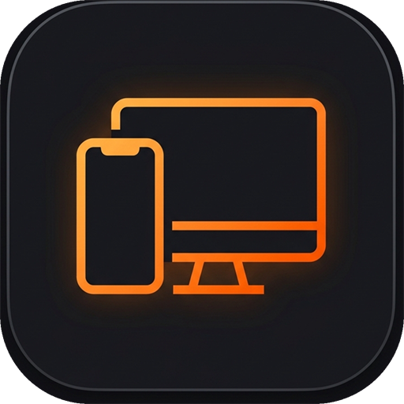
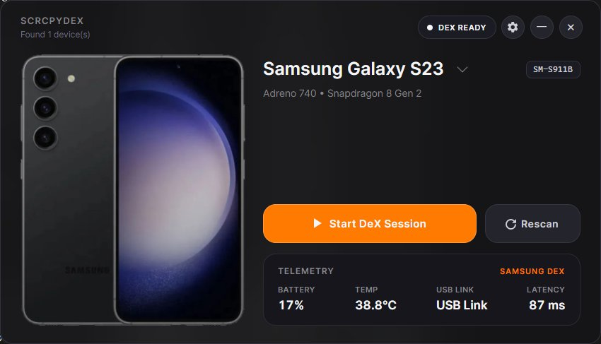
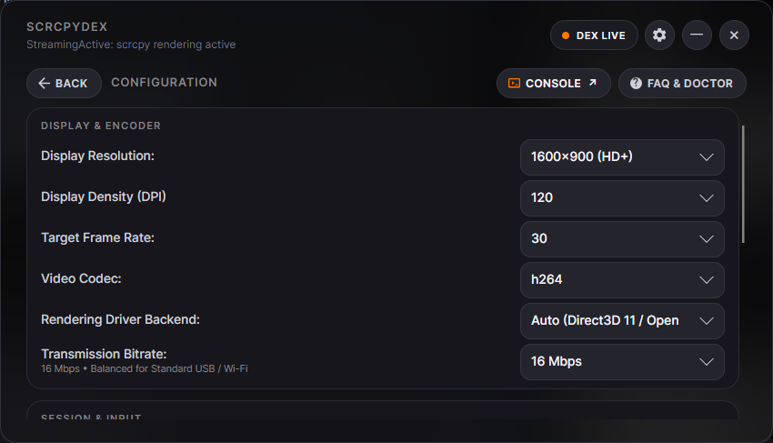

<p align="center">
  
</p>

<h1 align="center">ScrcpyDeX</h1>

<p align="center">
  Open-source Windows client to launch Samsung DeX (or Android screen mirroring) over USB using <code>scrcpy</code> and ADB.
</p>

---

## Author's Note

> *"Hey! Aureliano here. I want to make it crystal clear that my direct participation in this codebase was roughly, let's say, 10%. I simply brought the original idea to the table and actively guided the autonomous AI coding agents step-by-step. There might be grotesque bugs, or there might be none at all—what truly matters to me is that this project completely solved my real-world need!"*

---

## Preview

<table>
  <tr>
    <td align="center"><br><sub><b>Main Device &amp; Telemetry View</b></sub></td>
    <td align="center"><br><sub><b>Settings Window</b></sub></td>
  </tr>
</table>

---

## Features

* **USB Communication:** Connects directly over a standard USB cable via ADB without requiring Wi-Fi or wireless pairing.
* **Multi-Language Support:** Interface localized across 6 languages with runtime switching (`English`, `Português (BR)`, `Español`, `Deutsch`, `Français`, `简体中文`).
* **In-App Settings:** Built-in settings panel to configure display resolution (including custom dimensions), DPI, FPS, bitrate, video codec, render driver, audio/input options, language, and custom `scrcpy`/`adb` paths.

---

## Testing Scope & Device Behavior

* **Tested Hardware:** Physical testing was performed **only on a Samsung Galaxy S23**. Other Galaxy DeX devices and non-DeX Android models have not been physically tested.
* **Non-DeX Devices:** Devices that are not compatible with Samsung DeX automatically start standard **Screen Mirroring** (main display) instead.

---

## Prerequisites & System Requirements

Before using ScrcpyDeX, make sure your PC and device meet these requirements:

1. **Operating System:** **Windows 10** (version 1607+) or **Windows 11** (64-bit). Windows 7 and 8.1 are not supported (`.NET 8` requirement).
2. **Official `scrcpy` (>= 2.4) & `adb`:** Required for `--display-id` and `--mouse=uhid` support. On Windows, the official `scrcpy` package **already includes `adb.exe`** in the same directory—installing `scrcpy` provides both tools:
   ```powershell
   # Recommended (WinGet)
   winget install Genymobile.scrcpy

   # Or via Scoop
   scoop install scrcpy
   ```
   *(Alternatively, extract the official Windows archive from [Genymobile/scrcpy Releases](https://github.com/Genymobile/scrcpy/releases) and add it to `PATH`, or select the executables manually in Settings.)*
3. **USB Debugging Enabled:** On your phone, enable **Developer options** and turn on **USB debugging**.

---

## Quick Start (Windows)

1. Download and extract the Windows release archive (`ScrcpyDeX-v2.0.0-win-x64.zip`) from [GitHub Releases](https://github.com/Aureliano021/ScrcpyDex/releases).
2. Make sure **`adb`** and **`scrcpy` (>= 2.4)** are installed.
3. Connect your phone via USB with **USB debugging** enabled and accept the RSA authorization prompt on the device.
4. Launch **`ScrcpyDex.App.exe`**.
5. Click **Start DeX Session** (or **Start Screen Mirroring** on devices without DeX support).
6. To stop the session and restore the phone screen cleanly, click **Stop Session** or close the `scrcpy` window (`Alt + F4`).

---

## Linux Status

Linux support is roughly halfway ready in the repository (the cross-platform `.NET 8` / Avalonia codebase, CLI, and Linux helpers/packaging recipes are already implemented), though the current version has **not yet been tested on an actual Linux machine**.
