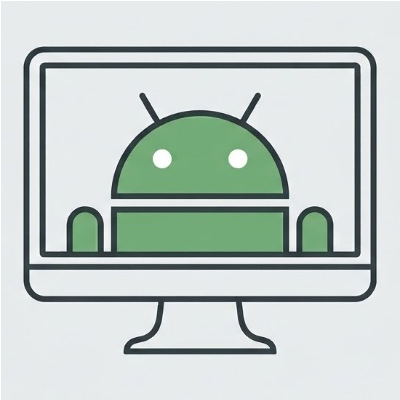
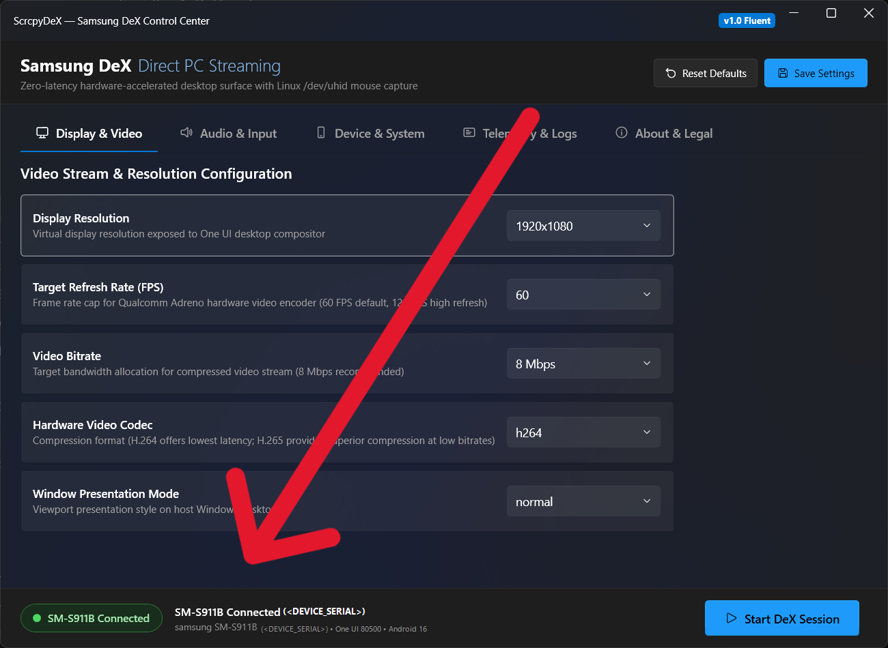

<p align="center">
  
</p>

<h1 align="center">ScrcpyDeX</h1>

<p align="center">
  <b>Open-source client for Samsung DeX on PC via USB</b><br>
  Low-latency 60 FPS desktop streaming, Linux UHID mouse emulation, audio forwarding, and rootless operation across Windows and Linux.
</p>

<p align="center">
  <a href="https://github.com/Aureliano021/ScrcpyDex/releases/latest"></a>
  <a href="https://www.microsoft.com/windows"></a>
  <a href="https://www.samsung.com"></a>
  <a href="https://www.samsung.com/galaxy-s23/"></a>
  <a href="LICENSE"></a>
</p>

---

> [!NOTE]
> **Independent Open-Source Project & Non-Affiliation Notice:**  
> ScrcpyDeX is an independent, community-driven project and is **NOT** affiliated with, sponsored by, or endorsed by **Samsung Electronics Co., Ltd.** or **Google LLC**. "Samsung", "Samsung DeX", "Galaxy", and "One UI" are registered trademarks of Samsung Electronics Co., Ltd. For full legal terms, warranty disclaimers, and reverse engineering analysis, please read the [**Legal Disclaimer & Terms of Interoperability**](docs/DISCLAIMER.md) and [**Legal Compliance Analysis**](docs/LEGAL_AND_LICENSING.md).

---

## ✍️ Author's Note

> *"Hey! Aureliano here. I want to make it crystal clear that my direct participation in this codebase was roughly, let's say, 10%. I simply brought the original idea to the table and actively guided the autonomous AI coding agents step-by-step. There might be grotesque bugs, or there might be none at all—what truly matters to me is that this project completely solved my real-world need!"*

---

## ⚡ Key Features

* **Runs Over USB (No Wi-Fi Needed):** Streams directly through standard ADB port forwards over a USB cable, bypassing wireless network congestion, bandwidth throttles, and local network restrictions.
* **Cross-Platform Hardware Acceleration:** 60 FPS video decoding handled via `scrcpy` using Direct3D11 on Windows and OpenGL with VA-API hardware decoding on Linux (Intel i965/iHD, AMD radeonsi).
* **Native Desktop Mouse Emulation (UHID):** Injects pointer events via Linux kernel `/dev/uhid` so Android recognizes a physical USB mouse—supporting native desktop cursor icons, hover states, fluid scroll wheel, and right-click context menus.
* **Audio Forwarding:** Captures DeX audio on the device and forwards it to PC speakers or headphones over USB (WASAPI on Windows, SDL/PipeWire/PulseAudio on Linux).
* **Standard ADB Privileges (UID 2000):** Operates under standard development user context (`UID 2000 shell`) without root access — Knox warranty bit (`0x0`) remained untouched on the tested Galaxy S23 device.
* **Automated Session Cleanup:** Closes the session, restores the phone screen to its previous state, and terminates background daemons automatically upon window close (Win32 Job Objects on Windows; POSIX process group signals on Linux).

---

## 🖥️ Platform Support & Client Applications

ScrcpyDeX supports both **Microsoft Windows** (10/11 x64) and **Linux** (Ubuntu 24.04 LTS noble, Linux Mint 22.3 Zena x86_64, and compatible Debian/Ubuntu derivatives). Three client interfaces are available:

| Client | Binary / Project | Target Platforms | Description |
|---|---|---|---|
| **ScrcpyDeX CLI** | `scrcpydex` (`src/ScrcpyDex.Cli`) | Linux x64, Windows x64 | Lightweight, headless, terminal-based control and scriptable workflows. |
| **ScrcpyDeX Avalonia GUI** | `ScrcpyDex.App` (`src/ScrcpyDex.App`) | Linux x64 (X11 / XWayland), Windows x64 | Cross-platform desktop GUI with visual device management and inline configuration. |
| **ScrcpyDeX WPF GUI** | `ScrcpyDeX.exe` (`src/ScrcpyDex.App.Wpf`) | Windows 10/11 x64 | Native Windows desktop GUI featuring Windows 11 Fluent styling and Mica effects. |

---

## 📋 System Prerequisites

1. **Samsung Galaxy Device:** A device with native Samsung DeX support (Galaxy S-series, Note-series, Z Fold, or Tab S-series). Verified baseline: Samsung Galaxy S23 (`SM-S911B`) running One UI 8.5 (Android 16).
2. **USB Debugging Enabled:** Enable *Developer options* on your device, then turn on *USB debugging*.
3. **Android Debug Bridge (ADB):** Installed on the host PC (`adb` in system `PATH`).
4. **Official scrcpy >= 2.4:** Installed on the host PC. Version 2.4 is the minimum requirement for the `--mouse=uhid` and `--display-id` options used by ScrcpyDeX. Older versions are unsupported.
   * **Linux Notice:** The distro `apt` package in Ubuntu 24.04 (`noble`) provides `scrcpy` 1.25, which is unsupported due to missing `--mouse=uhid` and `--display-id`. Users must install the official upstream standalone build or Snap package.
5. **Linux USB Permissions (Linux hosts):** udev rules deployed to `/etc/udev/rules.d/51-android.rules` and the desktop user added to the `plugdev` group.
6. **Hardware Video Acceleration (Linux hosts):** VA-API drivers installed (`i965-va-driver` or `intel-media-va-driver` for Intel, `mesa-va-drivers` for AMD).

For comprehensive Linux configuration instructions, see the [**Linux Setup & Installation Guide**](docs/LINUX_SETUP_GUIDE.md).

---

## 💻 ScrcpyDeX CLI Commands

The ScrcpyDeX CLI (`scrcpydex`) provides commands for terminal-based operation and system verification:

```bash
# Run system environment health check (scrcpy version, ADB, udev, VA-API)
scrcpydex doctor

# List connected and authorized devices
scrcpydex devices

# Start Samsung DeX session on the default or only connected device
scrcpydex start

# Start session with custom streaming parameters
scrcpydex start --serial <DEVICE_SERIAL> --bitrate 8000000 --max-fps 60 --max-size 1920

# Stop active session and restore phone screen
scrcpydex stop

# Inspect or update persisted settings
scrcpydex config get
scrcpydex config set video.bitrate 8000000
scrcpydex config path
```

---

## 🚀 Quick Start

### Windows

1. Download the Windows package (`ScrcpyDeX-v*-win-x64.zip`) from **[GitHub Releases](https://github.com/Aureliano021/ScrcpyDex/releases/latest)** and extract it.
2. Connect your Samsung Galaxy phone via USB with USB debugging enabled.
3. Launch **`ScrcpyDeX.exe`** (or run `ScrcpyDeX.bat`).
4. Confirm your device is recognized by the status bar:

   

5. Click **Start DeX Session**.
6. **Emergency Disconnect:** Run `.\stop-dex.bat` to terminate lingering sessions and reset ADB tunnels.

### Linux (Ubuntu / Linux Mint)

1. Ensure prerequisites are met: install official `scrcpy >= 2.4`, `adb`, and set up USB udev rules. See the [**Linux Setup Guide**](docs/LINUX_SETUP_GUIDE.md).
2. Connect your Samsung Galaxy phone via USB and authorize the computer prompt.
3. Verify your environment:
   ```bash
   scrcpydex doctor
   ```
4. Start a DeX session via CLI or GUI:
   * **CLI:** `scrcpydex start`
   * **GUI:** `./ScrcpyDex.App` (or launch `scrcpydex-gui`)
5. **Emergency Disconnect:** Run `scrcpydex stop` or execute `./packaging/linux/stop-dex.sh`.

---

## ⌨️ Controls & Shortcuts

| Action | Windows Shortcut | Linux Shortcut (X11 / Wayland) | Description |
| :--- | :--- | :--- | :--- |
| **Release Mouse Capture** | `Left Alt` or `Windows Key` | `Left Alt` | Releases the captured mouse cursor from the DeX window back to the host window manager. |
| **Toggle Fullscreen** | `Alt + F` | `Alt + F` | Toggles borderless fullscreen display mode. |
| **Close & Restore Phone** | `Alt + F4` or Click `[X]` | `Alt + F4` or Click `[X]` | Closes the DeX window and automatically tears down the session on the phone. |
| **Emergency Disconnect** | `stop-dex.bat` | `scrcpydex stop` / `stop-dex.sh` | Terminal command to force-kill lingering host processes and restore mobile display. |

---

## 📁 Project Structure

```text
ScrcpyDex/
├── .github/              # Contributor guidelines (CONTRIBUTING.md) and CI workflows
├── assets/               # Application icons, logos, and vector assets
├── config/               # Session configuration (settings.json, settings.schema.json)
├── docs/                 # Technical reports, guides, protocol specifications, and legal audits
│   ├── LINUX_SETUP_GUIDE.md # Step-by-step setup guide for Linux users
│   ├── PROTOCOL.md       # Binary protocol and handshake specification
│   ├── THIRD_PARTY_NOTICES.md # Third-party open source licenses and attributions
│   └── reports/          # Architectural reports and empirical validation logs
├── packaging/            # Platform distribution files
│   ├── linux/            # Linux udev rules (51-android.rules), desktop entry, and scripts
│   └── windows/          # Windows deployment assets
├── server/               # Java loopback display daemon (scrcpydex-server.jar)
├── src/                  # Source code directory
│   ├── ScrcpyDex.Core/   # Portable .NET 8 core library (models, state machine, platform abstractions)
│   ├── ScrcpyDex.Cli/    # Cross-platform CLI application (doctor, devices, start, stop, config)
│   ├── ScrcpyDex.App/    # Cross-platform desktop GUI (Avalonia UI for Linux and Windows)
│   └── ScrcpyDex.App.Wpf/# Windows desktop GUI (.NET 8 WPF with Fluent styling)
├── tests/                # Automated verification test suites (Core xUnit tests, gate scripts)
├── tools/                # Build utilities, icon compilers, and fallback launchers
├── LICENSE               # Apache License 2.0
├── README.md             # Project documentation and landing page
├── ScrcpyDeX.bat         # Windows launcher script
└── stop-dex.bat          # Windows emergency session disconnect script
```

---

## 🛠️ Architecture & How It Works

```
        Host PC (Windows / Linux Client)                  Samsung Galaxy (Target Device)
  ┌──────────────────────────────────────────────┐     ┌────────────────────────────────────┐
  │  ScrcpyDeX Client                            │     │  scrcpydex-server.jar (app_process)│
  │  - CLI: scrcpydex (ScrcpyDex.Cli)            │     │                                    │
  │  - GUI: ScrcpyDex.App / ScrcpyDex.App.Wpf    │     │  [DexActivator (Loopback RTSP)]    │
  │                                              │◄───►│   - 127.0.0.1:7236 Loopback        │
  │  [Official scrcpy >= 2.4 Streaming Client]   │ USB │   - SemWifiDisplay IPC Hook        │
  │   - Video: Direct3D11 (Win) / VA-API (Linux) │(ADB)│                                    │
  │   - Audio: WASAPI (Win) / SDL (Linux)        │     │  [Android OS & Kernel]             │
  │   - Input: Linux /dev/uhid Mouse Driver      │     │   - Virtual Display (DPI 160)      │
  │                                              │     │   - /dev/uhid (Group 3011)         │
  │  [Lifecycle & Process Management]            │     │   - Hardware Video Encoder (H.264) │
  │   - Win32 Job Objects / POSIX Process Groups │     │                                    │
  └──────────────────────────────────────────────┘     └────────────────────────────────────┘
```

1. **Loopback Display Activator (`server/scrcpydex-server.jar`):**  
   Binds Samsung's internal wireless display service to `127.0.0.1:7236` via `app_process` under standard shell user context (`UID 2000 shell`). The device treats this local connection as an external sink and allocates an isolated Samsung DeX desktop display named `"ScrcpyDeX"`.
2. **Display ID Discovery:**  
   Parses `dumpsys display` or daemon output to resolve the virtual display ID assigned to DeX (e.g. Display ID 9), ensuring `scrcpy` attaches to the desktop workspace rather than mirroring the primary mobile screen.
3. **Hardware Video Decoding & UHID Mouse (`scrcpy --display-id=... --mouse=uhid`):**  
   `scrcpy` captures the DeX stream using hardware video decoding (Direct3D11 on Windows; VA-API OpenGL on Linux). It forwards host mouse events into Android's `/dev/uhid` driver to provide genuine desktop cursor physics, hover states, and button bindings.
4. **Automated Lifecycle & Cleanup:**  
   Terminating the client or closing the window triggers a cleanup sequence that disconnects Samsung `system_server`, frees virtual display buffers, restores the mobile display, and clears ADB forward ports.

---

## 📂 Documentation & Deep Dives

* [**Linux Setup & Installation Guide:**](docs/LINUX_SETUP_GUIDE.md) Step-by-step setup instructions, udev rules, and VA-API troubleshooting for Linux users.
* [**Protocol Specification (SSOT):**](docs/PROTOCOL.md) Binary control protocol, handshake contracts, and packet structures.
* [**Report 01:** Server Core Architecture, Loopback Miracast RTSP & H.264 Video Pipeline](docs/reports/01_server_core_and_video.md)
* [**Report 02:** Control Channel Protocol, Input Event Injection & Coordinate Translation](docs/reports/02_control_channel_and_input.md)
* [**Report 03:** Unified Client, Linux Kernel UHID Mouse & Lifecycle Orchestration](docs/reports/03_unified_client_and_uhid_mouse.md)
* [**Report 04:** Desktop Configuration UI, Settings Persistence & Live Telemetry](docs/reports/04_configuration_ui_and_settings.md)
* [**Report 05:** Client Architecture, Resilient Process Engine & Systems Blueprint](docs/reports/05_client_architecture_and_design_patterns.md)
* [**Report 06:** Linux Mint / Ubuntu Hardware Validation & Baseline Feasibility (Phase 0)](docs/reports/06_linux_mint_hardware_validation.md)

---

## 🤝 Contributing

Contributions are welcome! Please review [**CONTRIBUTING.md**](.github/CONTRIBUTING.md) for details on clean-room engineering rules, Developer Certificate of Origin (DCO 1.1) sign-offs, and pull request guidelines.

---

## 📄 License & Legal Compliance

* **License:** Distributed under the [Apache License, Version 2.0](LICENSE).
* **Third-Party Notices:** See [docs/THIRD_PARTY_NOTICES.md](docs/THIRD_PARTY_NOTICES.md) for licenses and copyright attributions of external dependencies (`scrcpy`, Avalonia UI, WPF-UI, AOSP, FFmpeg).
* **Legal & Interoperability Compliance:** See [docs/LEGAL_AND_LICENSING.md](docs/LEGAL_AND_LICENSING.md) for clean-room audit documentation and legal interoperability analysis (DMCA 17 U.S.C. § 1201(f), EU Directive 2009/24/EC, Brazilian Software Law No. 9.609/1998).
* **Legal Disclaimer & Non-Affiliation:** See [docs/DISCLAIMER.md](docs/DISCLAIMER.md) for warranty disclaimers, Knox safety analysis, and trademark notices.
