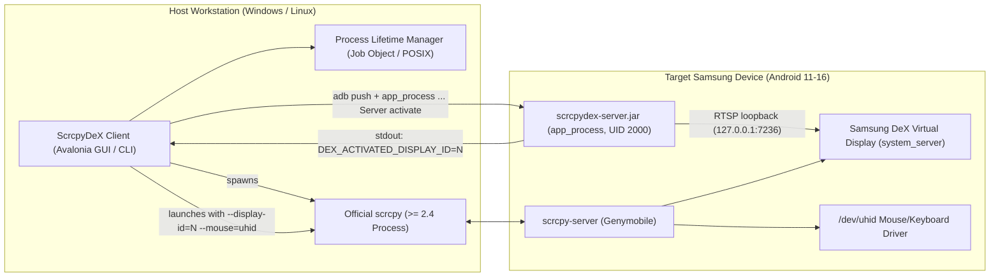

# Architecture Specification — ScrcpyDeX

**Version:** 2.0  
**Status:** Current Architecture Specification  
**Default Language:** English  

---

## 1. Executive Summary

ScrcpyDeX enables Samsung DeX desktop mode in a window on Windows and Linux host workstations via standard USB debugging, without requiring root privileges.

Rather than reimplementing proprietary video capture, encoding, and input injection protocols, ScrcpyDeX divides responsibilities into two distinct layers:
1. **Virtual Display Provisioning (`scrcpydex-server.jar`):** An on-device companion utility executed via Android's `app_process` under shell privileges (UID 2000) that initiates Samsung's internal desktop mode loopback sink, creating a virtual display in `system_server`.
2. **Media Streaming & Input Injection (`scrcpy` >= 2.4):** Upstream official `scrcpy` connects directly to the allocated virtual display ID, handling hardware-accelerated video streaming, rendering (Direct3D11 on Windows, VA-API on Linux), and low-latency mouse/keyboard handling via Android's `/dev/uhid` driver.

---

## 2. System Topology



---

## 3. Session Lifecycle & Execution Flow

### 3.1 Device Detection & Qualification
1. The host client uses `AdbDeviceTracker` to monitor ADB connection events via `host:track-devices-l`.
2. Upon connection, `SamsungDeviceModelResolver` queries the device model via `getprop ro.product.model` and checks hardware compatibility.
3. Supported Samsung Galaxy devices include S-series (S8 through S25), Note-series (Note 8 through Note 20), Z Fold-series, and Tab S-series.

### 3.2 Display Activation (`scrcpydex-server.jar activate`)
1. The host pushes `scrcpydex-server.jar` to `/data/local/tmp/scrcpydex-server.jar` if not already present or if the MD5/SHA checksum differs.
2. The host executes:
   ```bash
   CLASSPATH=/data/local/tmp/scrcpydex-server.jar app_process /data/local/tmp com.scrcpydex.server.Server activate
   ```
3. Inside `Server.java`:
   - `CompatCheck.verify()` validates that the device runs Android 11+ (API >= 30) and contains Samsung's `SemWifiDisplayConfig` classes.
   - `DisplayWatch` attaches a listener to Android's `DisplayManagerGlobal`.
   - `DexActivator` invokes `SemWifiDisplayConfig` via Java reflection to initiate a local loopback wireless display sink on `127.0.0.1:7236`.
   - Samsung's `system_server` initializes the desktop mode environment and allocates a virtual display (named `"ScrcpyDeX"`).
   - Once detected by `DisplayWatch`, the server prints the assigned display ID to standard output:
     ```
     DEX_ACTIVATED_DISPLAY_ID=<ID>
     ```
   - The server enters a wait loop, keeping the virtual display alive until a termination signal is received.

### 3.3 Streaming Handover (`scrcpy`)
1. The host application captures `DEX_ACTIVATED_DISPLAY_ID=<ID>` from the server's stdout stream.
2. The host launches the external `scrcpy` binary with tailored parameters:
   ```bash
   scrcpy -s <SERIAL> --display-id=<ID> --mouse=uhid --keyboard=uhid --stay-awake ...
   ```
3. `scrcpy` deploys its own minimal server agent (`scrcpy-server`) which captures frames directly from the designated virtual display ID and injects physical mouse/keyboard events via `/dev/uhid`.

### 3.4 Process Containment & Lifetime Management
To prevent orphaned processes if the host GUI is terminated unexpectedly (e.g., via Task Manager or application crash):
- **Windows:** `WindowsJobObjectLifetimeManager` creates a Win32 Job Object configured with `JOB_OBJECT_LIMIT_KILL_ON_JOB_CLOSE`. Child processes (`scrcpy.exe` and `adb.exe`) are assigned to this Job Object. When the host process exits, the Windows NT kernel automatically and atomically terminates all child processes in the job.
- **Linux:** `LinuxProcessLifetimeManager` and `PosixProcessLifetimeManager` use POSIX process groups and process-exit event hooks to clean up child processes.

### 3.5 Graceful Teardown
When the user closes the window (`Alt+F4` or `[X]`) or triggers disconnect:
1. `scrcpy` is closed.
2. The host executes the fast disconnect command on device:
   ```bash
   CLASSPATH=/data/local/tmp/scrcpydex-server.jar app_process /data/local/tmp com.scrcpydex.server.Server disconnect
   ```
3. The host broadcasts intent notifications to ensure Samsung One UI cleanly restores the phone's native display mode:
   ```bash
   am broadcast -a com.sec.android.app.desktoplauncher.ACTION_STOP_DESKTOP_MODE
   am broadcast -a com.samsung.android.desktopmode.action.DESKTOP_MODE_UPDATE --ez enabled false
   ```
4. If still active, the activator process is terminated via `pkill -f com.scrcpydex.server.Server`.

---

## 4. Key Differences from Prototype Mode (v1.x)

| Aspect | Legacy Prototype (v1.x full mode) | Current Architecture (v2.0) |
|---|---|---|
| **Display Activation** | `scrcpydex-server.jar` loopback | `scrcpydex-server.jar` loopback |
| **Video Delivery** | Custom H.264 stream over TCP port `27183` | Handled by upstream official `scrcpy` |
| **Input Injection** | Custom binary protocol over TCP port `27184` | Upstream `/dev/uhid` driver via `scrcpy` |
| **Network Sockets** | Opened `27183` and `27184` on `127.0.0.1` | **None.** No TCP server sockets opened by JAR |
| **Client Implementations** | Experimental scripts + `ffplay` | Cross-platform Avalonia GUI & CLI (.NET 8) |
| **Historical Reference** | Archived in [`docs/archive/PROTOCOL-legacy-v1.md`](archive/PROTOCOL-legacy-v1.md) | Documented in this file |
