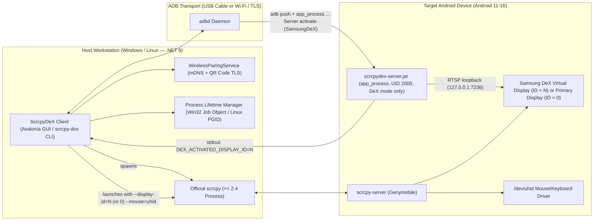

# Architecture Specification — ScrcpyDeX

**Version:** 2.1.0  
**Status:** Current Architecture Specification  
**Default Language:** English  

---

## 1. Executive Summary

ScrcpyDeX enables Samsung DeX desktop mode in a window on Windows and Linux host workstations over **USB** or **Wi-Fi** (Android 11+ Wireless Debugging QR Code pairing with TLS, or one-click USB-to-Wi-Fi transition), without requiring root privileges. On Android devices that do not support Samsung DeX, ScrcpyDeX automatically falls back to standard **Screen Mirroring** on the primary display (Display `0`).

Rather than reimplementing proprietary video capture, encoding, and input injection protocols, ScrcpyDeX divides responsibilities into two distinct layers:
1. **Virtual Display Provisioning (`scrcpydex-server.jar`):** On DeX-capable Samsung devices (`DeviceCapability.SamsungDeX`), an on-device companion utility executed via Android's `app_process` under shell privileges (UID 2000) initiates Samsung's internal desktop mode loopback sink, creating a virtual display in `system_server`.
2. **Media Streaming & Input Injection (`scrcpy` >= 2.4):** Upstream official `scrcpy` connects directly to the allocated virtual display ID (or Display `0` in Screen Mirroring mode), handling hardware-accelerated video streaming, rendering (Direct3D11 on Windows, OpenGL/VA-API on Linux), and low-latency mouse/keyboard handling via Android's `/dev/uhid` driver.

---

## 2. System Topology



---

## 3. Session Lifecycle & Execution Flow

### 3.1 Device Detection, Wireless Pairing & Qualification
1. **ADB Device Tracking:** `AdbDeviceTracker` monitors ADB connection events in real time via `host:track-devices-l` on TCP port `5037`, backed by `AdbResilienceService` (retries and circuit breaker).
2. **Wireless Onboarding (v2.1.0):**
   - **QR Code Pairing:** When no device is connected, `WirelessPairingService` generates a `WIFI:T:ADB;S:<service>;P:<password>;;` payload rendered via `QrCodeMatrixGenerator` / `QrCodeBitmapRenderer`, listens for Android `_adb-tls-pairing._tcp` and `_adb-tls-connect._tcp` mDNS announcements (`MdnsPacketParser`), pairs via `adb pair`, and connects over TLS.
   - **One-Click USB-to-Wi-Fi Switch:** When connected over USB, the GUI offers a one-click transition (`SwitchToWirelessCommand`) that prefers TLS wireless debugging if already paired/discoverable, or falls back to `adb tcpip 5555` + LAN IP connection.
3. **Dual-Mode Capability Resolution:** `SamsungDeviceModelResolver` inspects device properties (`ro.product.manufacturer`, `ro.product.model`, One UI / Android build properties) and classifies each device into:
   - `DeviceCapability.SamsungDeX` — DeX-capable Samsung Galaxy devices (S-series, Note-series, Z Fold-series, Tab S-series).
   - `DeviceCapability.SamsungMirrorOnly` — Samsung devices without DeX (e.g., Galaxy A/M/F, Z Flip), falling back to Display `0`.
   - `DeviceCapability.GenericMirrorOnly` — Non-Samsung Android devices, falling back to Display `0`.

### 3.2 Display Activation (`scrcpydex-server.jar activate`)
For `SamsungDeX` devices:
1. The host pushes `scrcpydex-server.jar` to `/data/local/tmp/scrcpydex-server.jar` (resolved from disk or extracted from the embedded assembly resource).
2. The host executes:
   ```bash
   CLASSPATH=/data/local/tmp/scrcpydex-server.jar app_process /data/local/tmp com.scrcpydex.server.Server activate
   ```
3. Inside `Server.java`:
   - `CompatCheck.verify()` validates that the device runs Android 11+ (API >= 30) and contains Samsung's `SemWifiDisplayConfig` classes.
   - `DisplayWatch` attaches a listener to Android's `DisplayManagerGlobal`.
   - `DexActivator` invokes `SemWifiDisplayConfig` via Java reflection to initiate a local loopback wireless display sink on `127.0.0.1:7236`.
   - Samsung's `system_server` initializes the desktop mode environment and allocates a virtual display (named `"ScrcpyDeX"`).
   - Once detected by `DisplayWatch`, the server prints the assigned display ID to standard output:
     ```
     DEX_ACTIVATED_DISPLAY_ID=<ID>
     ```
   - The server enters a wait loop, keeping the virtual display alive until a termination signal is received.

For `SamsungMirrorOnly` and `GenericMirrorOnly` devices, this step is skipped and `effectiveDisplayId` defaults to `0`.

### 3.3 Streaming Handover (`scrcpy`)
1. The host application transitions through `SessionStateMachine` (`Idle` → `DeviceConnecting` → `ServerDeploying` → `DisplayNegotiating` → `StreamingActive`) and captures `DEX_ACTIVATED_DISPLAY_ID=<ID>` (or `0` for Screen Mirroring).
2. `ScrcpyExecutionService` launches the external `scrcpy` binary with tailored parameters:
   ```bash
   scrcpy -s <SERIAL> --display-id=<ID> --mouse=uhid --keyboard=uhid ...
   ```
3. `NonBlockingProcessStream` asynchronously pumps `stdout`/`stderr` and classifies entries into `Info`, `Warning`, or `Error` so benign `stderr` progress lines never falsely trigger failure states.
4. `scrcpy` deploys its own minimal server agent (`scrcpy-server`) which captures frames directly from the designated display ID and injects mouse/keyboard events via `/dev/uhid`.

### 3.4 Process Containment & Lifetime Management
To prevent orphaned processes if the host GUI is terminated unexpectedly (e.g., via Task Manager or application crash):
- **Windows:** `WindowsJobObjectLifetimeManager` creates a Win32 Job Object configured with `JOB_OBJECT_LIMIT_KILL_ON_JOB_CLOSE`. Child processes (`scrcpy.exe` and `adb.exe`) are assigned to this Job Object so the Windows NT kernel terminates them atomically when the host exits.
- **Linux:** `LinuxProcessLifetimeManager` and `PosixProcessLifetimeManager` isolate child processes in POSIX process groups (`setpgid`) and tear them down (`SIGTERM` → `SIGKILL`) on exit.

### 3.5 Graceful Teardown
When the user closes the window (`Alt+F4` or `[X]`) or clicks **Stop Session**:
1. `scrcpy` is closed gracefully (with process-tree fallback if unresponsive).
2. In DeX mode, the host executes the fast disconnect command on the device:
   ```bash
   CLASSPATH=/data/local/tmp/scrcpydex-server.jar app_process /data/local/tmp com.scrcpydex.server.Server disconnect
   ```
3. The host broadcasts intent notifications to ensure Samsung One UI cleanly restores the phone's native display mode:
   ```bash
   am broadcast -a com.sec.android.app.desktoplauncher.ACTION_STOP_DESKTOP_MODE
   am broadcast -a com.samsung.android.desktopmode.action.DESKTOP_MODE_UPDATE --ez enabled false
   ```
4. If still active, the activator process is terminated via `pkill -f com.scrcpydex.server.Server`.

### 3.6 Configuration Persistence & Localization
- **Atomic Configuration:** `AtomicJsonConfigRepository<ScrcpyDeXSettings>` persists `settings.json` using two-phase `WriteThrough` temporary writes + `File.Replace` with `.bak` recovery.
- **Localization:** `LocalizationManager` provides runtime culture switching across 6 languages (`en`, `pt-BR`, `es`, `de`, `fr`, `zh-Hans`) with strict 1:1 `.resx` key parity.

---

## 4. Key Differences from Prototype Mode (v1.x)

| Aspect | Legacy Prototype (v1.x full mode) | Current Architecture (v2.1) |
|---|---|---|
| **Display Activation** | `scrcpydex-server.jar` loopback | `scrcpydex-server.jar` loopback (with Dual-Mode fallback to Display `0`) |
| **Video Delivery** | Custom H.264 stream over TCP port `27183` | Handled by upstream official `scrcpy` (`>= 2.4`) |
| **Input Injection** | Custom binary protocol over TCP port `27184` | Upstream `/dev/uhid` driver via `scrcpy` |
| **Connection Transport** | USB only | USB + Wireless ADB (QR Code TLS pairing & 1-click USB-to-Wi-Fi) |
| **Network Sockets** | Opened `27183` and `27184` on `127.0.0.1` | **None.** No TCP server sockets opened by JAR |
| **Client Implementations** | Experimental scripts + `ffplay` | Cross-platform Avalonia GUI (`ScrcpyDex.App`) & CLI (`scrcpy-dex`) on `.NET 8` |
| **Historical Reference** | Archived in [`docs/archive/PROTOCOL-legacy-v1.md`](archive/PROTOCOL-legacy-v1.md) | Documented in this file |
