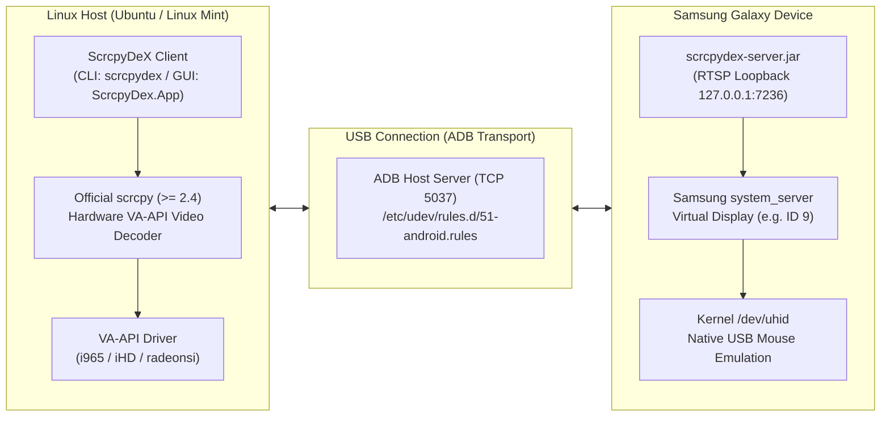

# Linux Setup & Installation Guide for ScrcpyDeX

**Document Version:** 1.0.0  
**Target Distributions:** Ubuntu 24.04 LTS (`noble`), Ubuntu 22.04 LTS (`jammy`), Linux Mint 22.x (`Zena`), Linux Mint 21.x  
**Tested Baseline:** Linux Mint 22.3 x86_64 (Kernel 6.8, X11) with Samsung Galaxy S23 (Android 16 / One UI 8.5)  

---

## Overview

This guide provides step-by-step instructions for configuring and running **ScrcpyDeX** on Linux desktop distributions. ScrcpyDeX enables rootless, hardware-accelerated Samsung DeX desktop mode over a standard USB cable using upstream `scrcpy` video streaming and Linux kernel `/dev/uhid` input injection.



---

## Quick Start: Automated One-Step Setup

For Ubuntu and Linux Mint users who prefer an automated installation without manually executing individual commands, run the setup optimizer script:

```bash
chmod +x scripts/setup-linux.sh scripts/run-linux.sh
./scripts/setup-linux.sh
```

This single command automatically:
1. Installs ADB and VA-API video decoding drivers (`mesa-va-drivers`, `intel-media-va-driver`).
2. Configures Samsung udev rules (`/etc/udev/rules.d/51-android.rules`) and adds your user to the `plugdev` group.
3. Downloads and configures upstream `scrcpy >= 2.4` directly if an incompatible distro package is detected.
4. Verifies the .NET 8 runtime and tests device connectivity.

Once finished, launch ScrcpyDeX with:
```bash
./scripts/run-linux.sh
```

---

## Section 1: Manual Prerequisites & Configuration

### 1.1 Hardware and System Requirements

* **Samsung Galaxy Device:** A device with native Samsung DeX support (Galaxy S-series, Note-series, Z Fold, or Tab S-series). Verified baseline: Samsung Galaxy S23 (`SM-S911B`) running One UI 8.5 (Android 16).
* **USB Cable:** Standard high-speed USB-C to USB-A or USB-C to USB-C data cable.
* **Host Operating System:** Ubuntu 24.04 LTS, Ubuntu 22.04 LTS, Linux Mint 22.x, or Linux Mint 21.x (x86_64).
* **Architecture:** 64-bit x86_64 (`linux-x64`). 32-bit x86 Linux is unsupported.

### 1.2 Why Distro `apt` Packages Cannot Be Used

The standard Ubuntu 24.04 (`noble`) package repository provides `scrcpy` version **1.25**. Version 1.25 is **incompatible** with ScrcpyDeX for the following technical reasons:

| Feature Required by ScrcpyDeX | Minimum scrcpy Version | Status in Ubuntu `apt` (1.25) | Impact if Using Distro Package |
|---|---|---|---|
| `--mouse=uhid` | **v2.4** | Absent | Cannot inject native hardware mouse cursor via `/dev/uhid`. Falls back to touch emulation, breaking desktop cursor physics, hover states, and right-click menus. |
| `--display-id` | **v2.2** | Absent | Cannot target the virtual Samsung DeX display. Version 1.25 can only mirror the default device display (ID 0). |
| Native Audio Forwarding | **v2.0** | Absent | Audio forwarding fails without external helper utilities. |

> [!IMPORTANT]
> You must install **official scrcpy >= 2.4**. ScrcpyDeX validates the runtime version of `scrcpy` and will exit with an error if version 1.25 or any version prior to 2.4 is detected.

### 1.3 Installing Android Debug Bridge (ADB)

Install the ADB client and fastboot packages from the official repositories:

```bash
sudo apt update
sudo apt install -y adb
```

Verify that the ADB binary is present:

```bash
adb version
```

### 1.4 Installing Official scrcpy (Version >= 2.4)

You can install upstream `scrcpy` using either the official standalone release archive (recommended) or the official Snap package.

#### Option A: Official Standalone Archive (Recommended)

Genymobile publishes precompiled, self-contained Linux binaries statically linked against modern FFmpeg and SDL libraries:

1. Download the latest x86_64 release archive from [Genymobile scrcpy Releases](https://github.com/Genymobile/scrcpy/releases):
   ```bash
   SCRCPY_VERSION="3.1"
   wget "https://github.com/Genymobile/scrcpy/releases/download/v${SCRCPY_VERSION}/scrcpy-linux-x86_64-v${SCRCPY_VERSION}.tar.gz"
   ```

2. Extract and install the binary and server jar to `/usr/local`:
   ```bash
   sudo tar -xzf "scrcpy-linux-x86_64-v${SCRCPY_VERSION}.tar.gz" -C /usr/local/
   sudo ln -sf "/usr/local/scrcpy-linux-x86_64-v${SCRCPY_VERSION}/scrcpy" /usr/local/bin/scrcpy
   ```

3. Ensure `/usr/local/bin` takes precedence in your `PATH`:
   ```bash
   hash -r
   which scrcpy
   ```

#### Option B: Official Snap Package

If your system supports Snap packages:

```bash
sudo snap install scrcpy
```

Ensure the Snap binary is accessible at `/snap/bin/scrcpy`.

#### Step 1.5: Verify scrcpy Version

Confirm that the active `scrcpy` binary reports version 2.4 or higher:

```bash
scrcpy --version
```

Example valid output:
```text
scrcpy 3.1 <https://github.com/Genymobile/scrcpy>
Dependencies:
 - SDL 2.30.0
 - libavcodec 60.31.102
 - libavformat 60.16.100
 - libavutil 58.29.100
```

---

## Section 2: Linux USB Permissions Setup

By default, standard user accounts on Linux do not have read/write access to raw USB character devices. Without proper udev rules, running `adb devices` produces `no permissions (missing udev rules?)`.

### 2.1 Install udev Rules

Create or deploy the udev rules file at `/etc/udev/rules.d/51-android.rules`:

```bash
sudo tee /etc/udev/rules.d/51-android.rules > /dev/null << 'EOF'
# udev rules for Samsung Android devices and ADB debugging
# Samsung Electronics
SUBSYSTEM=="usb", ATTR{idVendor}=="04e8", MODE="0666", GROUP="plugdev", TAG+="uaccess"

# Google (Generic ADB)
SUBSYSTEM=="usb", ATTR{idVendor}=="18d1", MODE="0666", GROUP="plugdev", TAG+="uaccess"
EOF
```

Set file permissions to standard read/write for root:

```bash
sudo chmod 644 /etc/udev/rules.d/51-android.rules
```

### 2.2 Add User to `plugdev` Group

Ensure your local desktop user is a member of the `plugdev` group:

```bash
# Ensure group exists
sudo groupadd -f plugdev

# Add current user to group
sudo usermod -aG plugdev "$USER"
```

> [!NOTE]
> Group membership changes require you to log out and log back in to your desktop session, or run `newgrp plugdev` within your current terminal shell.

### 2.3 Reload udev Subsystem

Apply the newly created rules immediately:

```bash
sudo udevadm control --reload-rules
sudo udevadm trigger
```

### 2.4 Verify ADB Connectivity

1. On your Samsung Galaxy device:
   - Navigate to **Settings** > **About phone** > **Software information**.
   - Tap **Build number** 7 times to enable **Developer options**.
   - Navigate to **Settings** > **Developer options** and enable **USB debugging**.
2. Connect your phone to your host PC via USB.
3. Restart the ADB server and list connected devices:
   ```bash
   adb kill-server
   adb start-server
   adb devices
   ```
4. A prompt will appear on your phone screen: **"Allow USB debugging?"**. Select **"Always allow from this computer"** and tap **Allow**.
5. Rerun `adb devices` to verify authorization:
   ```bash
   adb devices
   ```
   Expected output:
   ```text
   List of devices attached
   <DEVICE_SERIAL>    device
   ```
   If the state displays `unauthorized`, recheck the prompt on the device screen. If the state displays `no permissions`, recheck the udev rules and group membership.

---

## Section 3: Hardware Video Decoding Setup (VA-API)

Samsung DeX outputs a 1080p60 H.264 video stream. Hardware-accelerated video decoding offloads frame parsing to the host GPU, reducing CPU consumption from >80% to <5% on multi-core processors.

On Linux, hardware decoding is provided via the Video Acceleration API (**VA-API**).

### 3.1 Install VA-API Tools and Drivers

Install the diagnostic utility and driver packages appropriate for your GPU vendor:

```bash
sudo apt update
sudo apt install -y vainfo mesa-va-drivers
```

#### For Intel Graphics Hardware:

* **Legacy Intel (Sandy Bridge through Coffee Lake, Gen 4 to Gen 9):**
  Install the `i965` driver:
  ```bash
  sudo apt install -y i965-va-driver
  ```
* **Modern Intel (Broadwell, Skylake, Tiger Lake, Alder Lake, and newer):**
  Install the `intel-media` driver (iHD):
  ```bash
  sudo apt install -y intel-media-va-driver
  ```

#### For AMD Graphics Hardware:

AMD graphics drivers are included in `mesa-va-drivers` (`radeonsi`). Ensure your user has access to `/dev/dri/renderD128` (usually managed via `render` or `video` groups).

### 3.2 Verify VA-API Acceleration with `vainfo`

Run `vainfo` to query driver capabilities:

```bash
vainfo
```

Example verified output on Intel hardware:

```text
vainfo: VA-API version: 1.20 (libva 2.20.0)
vainfo: Driver version: Intel i965 driver for Intel(R) Sandybridge Desktop - 2.4.1
vainfo: Supported profile and entrypoints:
      VAProfileMPEG2Simple            : VAEntrypointVLD
      VAProfileMPEG2Main              : VAEntrypointVLD
      VAProfileH264ConstrainedBaseline: VAEntrypointVLD
      VAProfileH264Main               : VAEntrypointVLD
      VAProfileH264High               : VAEntrypointVLD
```

Confirm that the output lists **`VAProfileH264Main`** or **`VAProfileH264High`** with entrypoint **`VAEntrypointVLD`** (Variable Length Decoding = hardware decode).

### 3.3 Driver Selection & Environment Variables

If your system has multiple drivers or requires explicit driver selection, configure `LIBVA_DRIVER_NAME`:

```bash
# For legacy Intel hardware using i965
export LIBVA_DRIVER_NAME=i965

# For modern Intel hardware using iHD
# export LIBVA_DRIVER_NAME=iHD

# For AMD Radeon hardware
# export LIBVA_DRIVER_NAME=radeonsi
```

You can persist this variable in `~/.bashrc` or `~/.profile` if needed.

### 3.4 Hardware Codec Support: H.264 vs. HEVC (H.265)

| GPU Architecture | H.264 (AVC) Hardware Decode | HEVC (H.265) Hardware Decode | Recommended ScrcpyDeX Setting |
|---|---|---|---|
| **Intel Sandy Bridge / Ivy Bridge (2011–2012)** | Supported (`VAProfileH264High`) | **Unsupported** | `--video-codec=h264` |
| **Intel Haswell / Broadwell (2013–2015)** | Supported | Partial (8-bit hybrid on Broadwell) | `--video-codec=h264` |
| **Intel Skylake (2015) and newer** | Supported | Supported (8-bit/10-bit) | `--video-codec=h264` or `h265` |
| **AMD Radeon GCN 1.2 / RDNA (2015+)** | Supported | Supported | `--video-codec=h264` or `h265` |

> [!WARNING]
> On older hardware lacking HEVC decoding silicon (e.g. Intel Sandy Bridge), selecting `--video-codec=h265` causes FFmpeg to fall back to software CPU decode, which can elevate CPU load to 85–95% and cause dropped frames. The default configuration in `ScrcpyDex.Core` is `--video-codec=h264`.

---

## Section 4: Running ScrcpyDeX CLI (`scrcpydex`)

The ScrcpyDeX CLI (`scrcpydex` / `ScrcpyDex.Cli`) provides a lightweight, scriptable command-line interface for managing DeX sessions without launching a graphical window manager or desktop shell.

### 4.1 System Environment Diagnostics (`doctor`)

Run `scrcpydex doctor` to verify that all system dependencies, device permissions, and video acceleration drivers meet project requirements:

```bash
scrcpydex doctor
```

Example output:

```text
ScrcpyDeX System Diagnostic Report:
[OK] Operating System: Linux Mint 22.3 (Linux 6.8.0-generic x86_64)
[OK] Android Debug Bridge: /usr/bin/adb (version 1.0.41)
[OK] scrcpy Binary: /usr/local/bin/scrcpy (version 3.1 >= 2.4.0)
[OK] USB udev Configuration: /etc/udev/rules.d/51-android.rules present
[OK] User Group Membership: <username> in plugdev
[OK] Video Acceleration API: VA-API 1.20 initialized (driver: i965)
[OK] H.264 VA-API Hardware Decode: Supported (VAProfileH264High / VAEntrypointVLD)
[OK] Connected Devices: 1 authorized device (<DEVICE_SERIAL>)
```

### 4.2 Listing Connected Devices (`devices`)

Enumerate connected Android devices and inspect their status:

```bash
scrcpydex devices
```

Output format:
```text
Serial               Model           State        DeX Capable
----------------------------------------------------------------
<DEVICE_SERIAL>      SM-S911B        device       Yes (One UI 8.5)
```

### 4.3 Starting a DeX Session (`start`)

To deploy the server daemon, activate the loopback virtual display, and launch `scrcpy`:

```bash
scrcpydex start
```

#### Common Command-Line Flags:

* `--serial <SERIAL>`: Target a specific device if multiple phones are connected.
* `--bitrate <bps>`: Video streaming bitrate in bits per second (default: `8000000` / 8 Mbps).
* `--max-fps <fps>`: Maximum streaming frame rate (default: `60`).
* `--max-size <pixels>`: Maximum dimension in pixels (default: `1920`).
* `--codec <h264|h265>`: Video compression codec (default: `h264`).
* `--no-audio`: Disable audio forwarding over ADB.
* `--fullscreen`: Launch `scrcpy` directly in fullscreen mode.

Example with custom parameters:

```bash
scrcpydex start --bitrate 12000000 --max-fps 60 --max-size 1920
```

### 4.4 Stopping an Active Session (`stop`)

To terminate an active session, release the virtual display on the phone, and restore the mobile screen state:

```bash
scrcpydex stop
```

You can also specify a device serial if managing multiple endpoints:

```bash
scrcpydex stop --serial <DEVICE_SERIAL>
```

### 4.5 Inspecting and Modifying Settings (`config`)

ScrcpyDeX settings are persisted in `~/.config/scrcpydex/settings.json`:

```bash
# Print current active configuration
scrcpydex config get

# Set specific configuration property
scrcpydex config set video.bitrate 8000000
scrcpydex config set video.maxFps 60

# Print file system path of configuration file
scrcpydex config path
```

---

## Section 5: Running ScrcpyDeX Graphical Client

For users who prefer a graphical desktop interface, ScrcpyDeX provides `ScrcpyDex.App`, an Avalonia UI-based cross-platform client for Linux and Windows.

### 5.1 Launching the GUI Application

From the command line:

```bash
./ScrcpyDex.App
```

Or execute via the desktop entry:

```bash
scrcpydex-gui
```

### 5.2 Desktop Application Features

* **Device Selector:** Automatically detects USB hotplug events and populates authorized Samsung Galaxy devices.
* **Connection Health Indicator:** Displays real-time device connection state and DeX readiness.
* **Session Configuration:** Inline dropdowns to adjust video resolution, frame rate (30 / 60 FPS), bitrate (4 Mbps to 16 Mbps), and audio forwarding.
* **Lifecycle Controls:** One-click **Start DeX Session** and **Stop DeX Session** actions.
* **Telemetry and Logs:** Embedded console pane providing real-time log messages from `scrcpy` and `scrcpydex-server`.

---

## Section 6: Display Servers & Window Managers

### 6.1 X11 (Tested & Certified Baseline)

* **Status:** Tested and verified on Linux Mint Cinnamon (`X.Org 1.21.1`) and Ubuntu GNOME on Xorg (`DISPLAY=:0`).
* **Video Rendering:** `scrcpy` uses the SDL OpenGL 3.3 backend (`--render-driver=opengl`), providing stable frame pacing and low latency.
* **Mouse Integration:** Linux kernel `/dev/uhid` pointer events translate accurately across the X11 root window.
* **Pointer Release:** Pressing **`Left Alt`** releases mouse capture back to the host window manager.

### 6.2 Wayland & XWayland Considerations

* **Status:** Operational via **XWayland**. Native Wayland support (`Avalonia.Wayland`) remains experimental upstream.
* **XWayland Bridging:** On standard Wayland sessions (such as Ubuntu's default GNOME Wayland session), `scrcpy` runs through the XWayland compatibility bridge.
* **Pointer Capture / Confinement:** Wayland compositors enforce security boundaries around pointer locks. If pointer confinement behaves inconsistently under a specific window manager, verify that your compositor supports `zwp_confined_pointer_v1`.
* **Hotkey Interception:** On GNOME Wayland, the `Super` (Windows) key is reserved by Mutter for the desktop Activities overview. In ScrcpyDeX, use **`Left Alt`** as the primary pointer release hotkey to prevent interference with shell shortcuts.

---

## Section 7: Troubleshooting and Common Diagnostics

### Diagnostic Quick Reference

| Symptom | Probable Cause | Corrective Action |
|---|---|---|
| `adb devices` reports `no permissions` | Missing or incorrect udev rules, or user not in `plugdev` group. | Check `/etc/udev/rules.d/51-android.rules`, run `sudo usermod -aG plugdev $USER`, and reload udev rules. |
| `adb devices` reports `unauthorized` | Host RSA fingerprint not accepted on device. | Unlock phone and accept the **"Allow USB debugging?"** prompt. |
| `scrcpy: error: unrecognized option '--mouse=uhid'` | Obsolete distro `apt` version of `scrcpy` (1.25) is being executed. | Check `which scrcpy` and install official `scrcpy >= 2.4` from upstream. |
| `DEX_ACTIVATED_DISPLAY_ID not found` | Loopback handshake timed out or DeX mode unavailable. | Ensure device firmware supports DeX; run `scrcpydex stop` and retry. |
| `vaInitialize failed` in logs | VA-API driver missing or misconfigured. | Run `vainfo`, install `i965-va-driver` or `intel-media-va-driver`, and verify `LIBVA_DRIVER_NAME`. |
| Elevated CPU usage (>80%) | Fallback to software decoding. | Verify VA-API support with `vainfo`. On older GPUs, ensure `--video-codec=h264` is configured. |
| Audio does not play on host | SDL audio backend unable to connect to sound server. | Ensure PipeWire or PulseAudio is active; check `systemctl --user status pipewire`. |
| Pointer trapped inside window | Capture lock active in `scrcpy`. | Press `Left Alt` to release pointer capture. |

### Emergency Disconnect Script

If a session terminates unexpectedly or the device display does not restore automatically, execute the standalone emergency reset script:

```bash
./packaging/linux/stop-dex.sh
```

This script terminates remaining host `scrcpy` and server processes, sends the `disconnect` command to `com.scrcpydex.server.Server`, removes ADB port forwards, and dispatches broadcast intents (`ACTION_STOP_DESKTOP_MODE`) to restore the mobile display.
