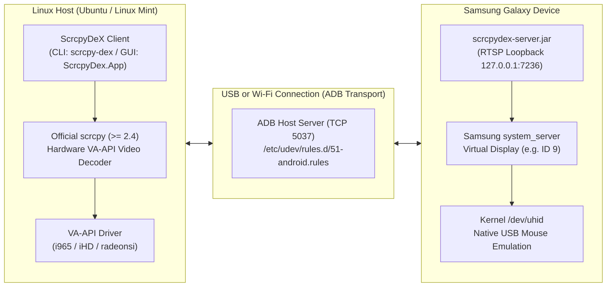

# Linux Setup & Installation Guide for ScrcpyDeX

**Document Version:** 2.1.0  
**Target Distributions:** Ubuntu 24.04 LTS (`noble`), Ubuntu 22.04 LTS (`jammy`), Linux Mint 22.x (`Zena`), Linux Mint 21.x  
**Tested Baseline:** Ubuntu / Linux Mint (x86_64) with Samsung Galaxy S23  

---

## Overview

This guide provides step-by-step instructions for configuring and running **ScrcpyDeX** on Linux desktop distributions. ScrcpyDeX enables rootless, hardware-accelerated Samsung DeX desktop mode over a standard **USB cable** or **Wi-Fi** (Android 11+ Wireless Debugging QR Code pairing or one-click USB-to-Wi-Fi transition) using upstream `scrcpy` video streaming and Linux kernel `/dev/uhid` input injection.

Non-DeX Android devices automatically fall back to standard **Screen Mirroring** (primary Display `0`).



---

## Quick Start: Automated One-Step Setup

For Ubuntu and Linux Mint users who prefer an automated installation without manually executing individual commands, run the setup optimizer script:

```bash
chmod +x scripts/setup-linux.sh scripts/run-linux.sh
./scripts/setup-linux.sh
```

This single command automatically:
1. Installs ADB and VA-API video decoding drivers (`mesa-va-drivers`, `intel-media-va-driver`).
2. Configures Samsung udev rules (`/etc/udev/rules.d/51-android.rules`) and adds your user to the `plugdev` group.
3. Downloads and configures upstream `scrcpy >= 2.4` directly if an incompatible distro package is detected.
4. Verifies the .NET 8 runtime/SDK and tests device connectivity.

Once finished, launch ScrcpyDeX with:
```bash
./scripts/run-linux.sh
```

---

## Section 1: Manual Prerequisites & Configuration

### 1.1 Hardware and System Requirements

* **Samsung Galaxy Device:** A device with native Samsung DeX support (Galaxy S-series, Note-series, Z Fold, or Tab S-series). Non-DeX Android devices automatically use Screen Mirroring.
* **Connection:** Standard USB data cable (with **USB debugging** enabled) or local Wi-Fi network (with **Wireless debugging** enabled for QR Code pairing).
* **Host Operating System:** Ubuntu 24.04 LTS, Ubuntu 22.04 LTS, Linux Mint 22.x, or Linux Mint 21.x (x86_64).
* **Architecture:** 64-bit x86_64 (`linux-x64`). 32-bit x86 Linux is unsupported.

### 1.2 Why Distro `apt` Packages Cannot Be Used

The standard Ubuntu 24.04 (`noble`) package repository provides `scrcpy` version **1.25**. Version 1.25 is **incompatible** with ScrcpyDeX for the following technical reasons:

| Feature Required by ScrcpyDeX | Minimum scrcpy Version | Status in Ubuntu `apt` (1.25) | Impact if Using Distro Package |
|---|---|---|---|
| `--mouse=uhid` | **v2.4** | Absent | Cannot inject native hardware mouse cursor via `/dev/uhid`. Falls back to touch emulation, breaking desktop cursor physics, hover states, and right-click menus. |
| `--display-id` | **v2.2** | Absent | Cannot target the virtual Samsung DeX display. Version 1.25 can only mirror the default device display (ID 0). |
| Native Audio Forwarding | **v2.0** | Absent | Audio forwarding fails without external helper utilities. |

> [!IMPORTANT]
> You must install **official scrcpy >= 2.4**. ScrcpyDeX validates the runtime version of `scrcpy` and will report an error if version 1.25 or any version prior to 2.4 is detected.

### 1.3 Installing Android Debug Bridge (ADB)

Install the ADB client from the official repositories:

```bash
sudo apt update
sudo apt install -y adb
```

Verify that the ADB binary is present:

```bash
adb version
```

### 1.4 Installing Official scrcpy (Version >= 2.4)

You can install upstream `scrcpy` using either the official standalone release archive (recommended) or the official Snap package.

#### Option A: Official Standalone Archive (Recommended)

Genymobile publishes precompiled, self-contained Linux binaries statically linked against modern FFmpeg and SDL libraries:

1. Download the latest x86_64 release archive from [Genymobile scrcpy Releases](https://github.com/Genymobile/scrcpy/releases):
   ```bash
   SCRCPY_VERSION="3.1"
   wget "https://github.com/Genymobile/scrcpy/releases/download/v${SCRCPY_VERSION}/scrcpy-linux-x86_64-v${SCRCPY_VERSION}.tar.gz"
   ```

2. Extract and install the binary and server jar to `/usr/local`:
   ```bash
   sudo tar -xzf "scrcpy-linux-x86_64-v${SCRCPY_VERSION}.tar.gz" -C /usr/local/
   sudo ln -sf "/usr/local/scrcpy-linux-x86_64-v${SCRCPY_VERSION}/scrcpy" /usr/local/bin/scrcpy
   ```

3. Ensure `/usr/local/bin` takes precedence in your `PATH`:
   ```bash
   hash -r
   which scrcpy
   ```

#### Option B: Official Snap Package

If your system supports Snap packages:

```bash
sudo snap install scrcpy
```

Ensure the Snap binary is accessible at `/snap/bin/scrcpy`.

#### Step 1.5: Verify scrcpy Version

Confirm that the active `scrcpy` binary reports version 2.4 or higher:

```bash
scrcpy --version
```

Example valid output:
```text
scrcpy 3.1 <https://github.com/Genymobile/scrcpy>
Dependencies:
 - SDL 2.30.0
 - libavcodec 60.31.102
 - libavformat 60.16.100
 - libavutil 58.29.100
```

---

## Section 2: Linux USB Permissions Setup

By default, standard user accounts on Linux do not have read/write access to raw USB character devices. Without proper udev rules, running `adb devices` produces `no permissions (missing udev rules?)`.

### 2.1 Install udev Rules

Create or deploy the udev rules file at `/etc/udev/rules.d/51-android.rules`:

```bash
sudo tee /etc/udev/rules.d/51-android.rules > /dev/null << 'EOF'
# udev rules for Samsung Android devices and ADB debugging
# Samsung Electronics
SUBSYSTEM=="usb", ATTR{idVendor}=="04e8", MODE="0666", GROUP="plugdev", TAG+="uaccess"

# Google (Generic ADB)
SUBSYSTEM=="usb", ATTR{idVendor}=="18d1", MODE="0666", GROUP="plugdev", TAG+="uaccess"
EOF
```

Set file permissions to standard read/write for root:

```bash
sudo chmod 644 /etc/udev/rules.d/51-android.rules
```

### 2.2 Add User to `plugdev` Group

Ensure your local desktop user is a member of the `plugdev` group:

```bash
# Ensure group exists
sudo groupadd -f plugdev

# Add current user to group
sudo usermod -aG plugdev "$USER"
```

> [!NOTE]
> Group membership changes require you to log out and log back in to your desktop session, or run `newgrp plugdev` within your current terminal shell.

### 2.3 Reload udev Subsystem

Apply the newly created rules immediately:

```bash
sudo udevadm control --reload-rules
sudo udevadm trigger
```

### 2.4 Verify ADB Connectivity

1. On your Samsung Galaxy device:
   - Navigate to **Settings** > **About phone** > **Software information**.
   - Tap **Build number** 7 times to enable **Developer options**.
   - Navigate to **Settings** > **Developer options** and enable **USB debugging** (and/or **Wireless debugging** for QR Code pairing).
2. Connect your phone to your host PC via USB.
3. Restart the ADB server and list connected devices:
   ```bash
   adb kill-server
   adb start-server
   adb devices
   ```
4. A prompt will appear on your phone screen: **"Allow USB debugging?"**. Select **"Always allow from this computer"** and tap **Allow**.
5. Rerun `adb devices` to verify authorization:
   ```bash
   adb devices
   ```
   Expected output:
   ```text
   List of devices attached
   <DEVICE_SERIAL>    device
   ```
   If the state displays `unauthorized`, recheck the prompt on the device screen. If the state displays `no permissions`, recheck the udev rules and group membership.

---

## Section 3: Hardware Video Decoding Setup (VA-API)

Samsung DeX outputs a 1080p H.264/H.265 video stream. Hardware-accelerated video decoding offloads frame parsing to the host GPU, reducing CPU consumption significantly on multi-core processors.

On Linux, hardware decoding is provided via the Video Acceleration API (**VA-API**).

### 3.1 Install VA-API Tools and Drivers

Install the diagnostic utility and driver packages appropriate for your GPU vendor:

```bash
sudo apt update
sudo apt install -y vainfo mesa-va-drivers
```

#### For Intel Graphics Hardware:

* **Legacy Intel (Sandy Bridge through Coffee Lake, Gen 4 to Gen 9):**
  Install the `i965` driver:
  ```bash
  sudo apt install -y i965-va-driver
  ```
* **Modern Intel (Broadwell, Skylake, Tiger Lake, Alder Lake, and newer):**
  Install the `intel-media` driver (iHD):
  ```bash
  sudo apt install -y intel-media-va-driver
  ```

#### For AMD Graphics Hardware:

AMD graphics drivers are included in `mesa-va-drivers` (`radeonsi`). Ensure your user has access to `/dev/dri/renderD128` (usually managed via `render` or `video` groups).

### 3.2 Verify VA-API Acceleration with `vainfo`

Run `vainfo` to query driver capabilities:

```bash
vainfo
```

Confirm that the output lists **`VAProfileH264Main`** or **`VAProfileH264High`** with entrypoint **`VAEntrypointVLD`** (Variable Length Decoding = hardware decode).

### 3.3 Driver Selection & Environment Variables

If your system has multiple drivers or requires explicit driver selection, configure `LIBVA_DRIVER_NAME`:

```bash
# For legacy Intel hardware using i965
export LIBVA_DRIVER_NAME=i965

# For modern Intel hardware using iHD
# export LIBVA_DRIVER_NAME=iHD

# For AMD Radeon hardware
# export LIBVA_DRIVER_NAME=radeonsi
```

You can persist this variable in `~/.bashrc` or `~/.profile` if needed.

### 3.4 Hardware Codec Support: H.264 vs. HEVC (H.265)

| GPU Architecture | H.264 (AVC) Hardware Decode | HEVC (H.265) Hardware Decode | Recommended ScrcpyDeX Setting |
|---|---|---|---|
| **Intel Sandy Bridge / Ivy Bridge (2011–2012)** | Supported (`VAProfileH264High`) | **Unsupported** | `--codec h264` |
| **Intel Haswell / Broadwell (2013–2015)** | Supported | Partial (8-bit hybrid on Broadwell) | `--codec h264` |
| **Intel Skylake (2015) and newer** | Supported | Supported (8-bit/10-bit) | `--codec h264` or `h265` |
| **AMD Radeon GCN 1.2 / RDNA (2015+)** | Supported | Supported | `--codec h264` or `h265` |

> [!WARNING]
> On older hardware lacking HEVC decoding silicon (e.g. Intel Sandy Bridge), selecting `--codec h265` causes FFmpeg to fall back to software CPU decode, which can elevate CPU load and cause dropped frames.

---

## Section 4: Running ScrcpyDeX CLI (`scrcpy-dex`)

The ScrcpyDeX CLI (`scrcpy-dex` / `ScrcpyDex.Cli`) provides a lightweight, scriptable command-line interface for managing DeX and screen mirroring sessions without launching a graphical window manager. If running from source, replace `scrcpy-dex` with `./scripts/run-linux.sh --cli`.

### 4.1 System Environment Diagnostics (`doctor`)

Run `scrcpy-dex doctor` to verify that all system dependencies, device permissions, and video acceleration drivers meet project requirements:

```bash
scrcpy-dex doctor
```

### 4.2 Listing Connected Devices (`devices`)

Enumerate connected Android devices and inspect their status and capability tier (`SamsungDeX`, `SamsungMirrorOnly`, `GenericMirrorOnly`):

```bash
scrcpy-dex devices
```

### 4.3 Starting a Session (`start`)

To deploy the server daemon (on `SamsungDeX` devices), activate the loopback virtual display, and launch `scrcpy`:

```bash
scrcpy-dex start
```

#### Common Command-Line Flags:

* `-s`, `--serial <SERIAL>`: Target a specific device if multiple phones are connected.
* `--bitrate <bps>`: Video streaming bitrate (`8M`, `16M`, `24M`, or raw bps; default: `8000000`).
* `--fps` / `--max-fps <fps>`: Maximum streaming frame rate (default: `30`).
* `--resolution` / `--max-size <value>`: Display resolution (e.g., `1920x1080`, `native`) or max dimension.
* `--dpi <dpi>`: Virtual DeX display density in DPI (default: `160`).
* `--codec <h264|h265|av1>`: Video compression codec (default: `h264`).
* `--mouse <uhid|sdk|aoa|disabled>`: Mouse input driver (default: `uhid`).
* `--render-driver <auto|opengl|software>`: SDL render driver override.
* `--no-audio`: Disable audio forwarding over ADB.
* `--fullscreen`: Launch `scrcpy` directly in fullscreen mode.

Example with custom parameters:

```bash
scrcpy-dex start --bitrate 24M --fps 60 --resolution 1920x1080
```

### 4.4 Stopping an Active Session (`stop`)

To terminate an active session, release the virtual display on the phone, and restore the mobile screen state:

```bash
scrcpy-dex stop
```

You can also specify a device serial if managing multiple endpoints:

```bash
scrcpy-dex stop --serial <DEVICE_SERIAL>
```

### 4.5 Inspecting and Modifying Settings (`config`)

ScrcpyDeX settings are persisted in `~/.config/scrcpydex/settings.json` (or `$XDG_CONFIG_HOME/scrcpydex/settings.json`):

```bash
# Print full active configuration
scrcpy-dex config list

# Get a specific configuration property
scrcpy-dex config get display.bitrate

# Set specific configuration properties
scrcpy-dex config set display.bitrate 24000000
scrcpy-dex config set display.fps 60

# Print file system path of configuration file
scrcpy-dex config path
```

---

## Section 5: Running ScrcpyDeX Graphical Client (`ScrcpyDex.App`)

For users who prefer a graphical desktop interface, ScrcpyDeX provides `ScrcpyDex.App`, an Avalonia UI-based cross-platform client for Linux and Windows.

### 5.1 Launching the GUI Application

From an extracted release or local build:

```bash
./ScrcpyDex.App
```

Or if installed via `.deb` package:

```bash
scrcpydex
```

Or from source via the repository helper script:

```bash
./scripts/run-linux.sh
```

### 5.2 Desktop Application Features

* **USB & Wi-Fi Connection:** Automatically detects USB hotplug events via ADB, displays an in-app **QR Code** for Android 11+ Wireless Debugging pairing when idle, and supports one-click USB-to-Wi-Fi transition.
* **Dual-Mode Adaptation:** Starts Samsung DeX on supported Galaxy devices and automatically adapts to Screen Mirroring on non-DeX devices.
* **Real-Time Telemetry:** Displays battery level, device temperature, link status, and latency.
* **In-App Settings & Localization:** Configure resolution (including custom dimensions), DPI, FPS, bitrate, video codec (`H.264` / `H.265` / `AV1`), render driver, audio/input options, custom binary paths, and instant switching across 6 languages.
* **Dedicated Console & FAQ Diagnostics:** Open the real-time diagnostic `Console` window or run `Check Env` inside the built-in FAQ & Diagnostics view.

---

## Section 6: Display Servers & Window Managers

### 6.1 X11 (Tested Baseline)

* **Video Rendering:** `scrcpy` uses the SDL OpenGL backend (`--render-driver=opengl`), providing stable frame pacing and low latency.
* **Mouse Integration:** Linux kernel `/dev/uhid` pointer events translate accurately across the X11 root window.
* **Pointer Release:** Pressing **`Left Alt`** releases mouse capture back to the host window manager.

### 6.2 Wayland & XWayland Considerations

* **Status:** Operational via **XWayland**. Native Wayland support (`Avalonia.Wayland`) remains experimental upstream.
* **XWayland Bridging:** On standard Wayland sessions (such as Ubuntu's default GNOME Wayland session), `scrcpy` runs through the XWayland compatibility bridge.
* **Pointer Capture / Confinement:** Wayland compositors enforce security boundaries around pointer locks. If pointer confinement behaves inconsistently under a specific window manager, verify that your compositor supports `zwp_confined_pointer_v1`.
* **Hotkey Interception:** On GNOME Wayland, the `Super` (Windows) key is reserved by Mutter for the desktop Activities overview. In ScrcpyDeX, use **`Left Alt`** as the primary pointer release hotkey to prevent interference with shell shortcuts.

---

## Section 7: Troubleshooting and Common Diagnostics

### Diagnostic Quick Reference

| Symptom | Probable Cause | Corrective Action |
|---|---|---|
| `adb devices` reports `no permissions` | Missing or incorrect udev rules, or user not in `plugdev` group. | Check `/etc/udev/rules.d/51-android.rules`, run `sudo usermod -aG plugdev $USER`, and reload udev rules. |
| `adb devices` reports `unauthorized` | Host RSA fingerprint not accepted on device. | Unlock phone and accept the **"Allow USB debugging?"** prompt. |
| `scrcpy: error: unrecognized option '--mouse=uhid'` | Obsolete distro `apt` version of `scrcpy` (1.25) is being executed. | Check `which scrcpy` and install official `scrcpy >= 2.4` from upstream. |
| `DEX_ACTIVATED_DISPLAY_ID not found` | Loopback handshake timed out or DeX mode unavailable. | Ensure device firmware supports DeX; run `scrcpy-dex stop` and retry. |
| `vaInitialize failed` in logs | VA-API driver missing or misconfigured. | Run `vainfo`, install `i965-va-driver` or `intel-media-va-driver`, and verify `LIBVA_DRIVER_NAME`. |
| Elevated CPU usage (>80%) | Fallback to software decoding. | Verify VA-API support with `vainfo`. On older GPUs, ensure `--codec h264` is configured. |
| Audio does not play on host | SDL audio backend unable to connect to sound server. | Ensure PipeWire or PulseAudio is active; check `systemctl --user status pipewire`. |
| Pointer trapped inside window | Capture lock active in `scrcpy`. | Press `Left Alt` to release pointer capture. |

### Emergency Disconnect via CLI

If a session terminates unexpectedly or the device display does not restore automatically, execute:

```bash
scrcpy-dex stop
```

Or when running from the source repository:

```bash
./scripts/run-linux.sh --cli stop
```

This sends the `disconnect` command to `com.scrcpydex.server.Server`, dispatches broadcast intents (`ACTION_STOP_DESKTOP_MODE`) to restore the mobile display, and cleans up ScrcpyDeX processes.
