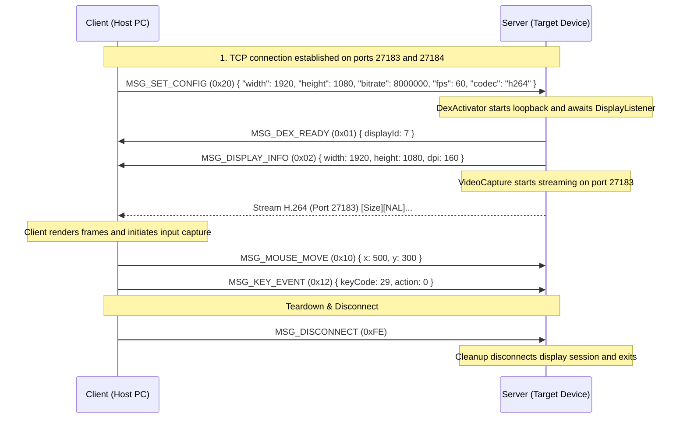

# Communication Protocol — ScrcpyDeX (SSOT)

**Status:** Normative Technical Specification  
**Protocol Version:** `1.0`  
**Recommended Transport:** TCP via `adb forward` tunnel exclusively over USB cable (`127.0.0.1`)

> [!WARNING]
> **Security & Transport Advisory:**  
> The control channel uses direct connections via local sockets (`127.0.0.1`) and does not incorporate application-layer encryption or token authentication. For this reason, **the supported and recommended transport is exclusively local via the `adb forward` tunnel over a USB cable**. Using ADB over Wi-Fi on open, public, or shared networks **is not recommended**, as entities on the same network could interact with the ADB daemon.

This document serves as the **Single Source of Truth (SSOT)** for the protocol specification between ScrcpyDeX clients and the Android server (`scrcpydex-server.jar`).

---

## 1. Connection Topology

**Two independent TCP ports** are established between the PC and the mobile device to ensure that heavy video streaming traffic does not impact the latency of control and input commands.

```
       Host PC (Client)                           Target Device (Server)
┌─────────────────────────────────┐           ┌─────────────────────────────────┐
│                                 │           │                                 │
│  [VideoDecoderService]          │           │  [VideoCapture]                 │
│  Local TCP Port: 27183 ◄────────┼─ adb fwd ─┼─ Local Port: 27183              │
│  (Continuous H.264 Stream)      │           │  (MediaCodec NAL units)         │
│                                 │           │                                 │
│  [InputService / AdbService]    │           │  [ControlChannel]               │
│  Local TCP Port: 27184 ◄────────┼─ adb fwd ─┼─ Local Port: 27184              │
│  (Bidirectional Messages)       │           │  (InputHandler / State Machine) │
│                                 │           │                                 │
└─────────────────────────────────┘           └─────────────────────────────────┘
```

Both sockets configure `TCP_NODELAY = true` (Nagle's algorithm disabled) for minimal latency.

---

## 2. Channel A: Video Stream (Port 27183)

* **Direction:** Server ➔ Client (Unidirectional)
* **Format:** Continuous raw H.264/H.265 stream in standard Annex B format (with NAL start codes `0x00 0x00 0x00 0x01` or `0x00 0x00 0x01` generated directly by `MediaCodec`).

### Advantages of Annex B format:
1. **Native compatibility with standard tools:** Enables immediate testing and inspection via `ffplay -f h264 tcp://127.0.0.1:27183`.
2. **Client decoupling:** The FFmpeg decoder on Windows consumes bytes directly via `av_parser_parse2()`, performing hardware/software packet division without proprietary header overhead.

---

## 3. Channel B: Control and Input Channel (Port 27184)

* **Direction:** Bidirectional (Client ⇄ Server)
* **Basic Message Structure:**
```
┌───────────────────────┬────────────────────────────────────────┐
│ Message Type (1 byte) │ Specific Payload (variable size)       │
│ uint8                 │ Defined by MSG_TYPE                    │
└───────────────────────┴────────────────────────────────────────┘
```

### 3.1. Server ➔ Client Messages (Events & Telemetry)

| Code | Name | Payload Size | Field Description |
| :--- | :--- | :--- | :--- |
| `0x01` | `MSG_DEX_READY` | 4 bytes | `int32 displayId` — Emitted when DeX has been activated and the display ID is confirmed. |
| `0x02` | `MSG_DISPLAY_INFO`| 12 bytes | `int32 width`, `int32 height`, `int32 dpi` — Actual resolution and density of DeX. |
| `0x03` | `MSG_HEARTBEAT` | 0 bytes | Periodic keep-alive for connection liveness. |
| `0xFF` | `MSG_ERROR` | 2 + N bytes | `uint16 strLen`, `utf8[strLen] message` — Fatal server error prior to shutdown. |

#### Details of `MSG_DISPLAY_INFO` (`0x02`):
```
[0x02] [4b: Width] [4b: Height] [4b: DPI]
Example (1080p @ 160 dpi):
02 00 00 07 80 00 00 04 38 00 00 00 A0
```

---

## 3.2. Client ➔ Server Messages (Commands & Input)

| Code | Name | Payload Size | Field Description |
| :--- | :--- | :--- | :--- |
| `0x10` | `MSG_MOUSE_MOVE` | 8 bytes | `int32 x`, `int32 y` — Cursor position in DeX coordinates. |
| `0x11` | `MSG_MOUSE_BUTTON` | 10 bytes | `int32 x`, `int32 y`, `uint8 button`, `uint8 action` |
| `0x12` | `MSG_KEY_EVENT` | 5 bytes | `int32 keyCode`, `uint8 action` (0=Down, 1=Up) |
| `0x13` | `MSG_SCROLL` | 16 bytes | `int32 x`, `int32 y`, `float32 hScroll`, `float32 vScroll` |
| `0x20` | `MSG_SET_CONFIG` | 2 + N bytes | `uint16 jsonLen`, `utf8[jsonLen] jsonPayload` — Initial configuration (resolution, bitrate, codec). |
| `0xFE` | `MSG_DISCONNECT` | 0 bytes | Request for clean shutdown of DeX and the server daemon. |

#### Details of Mouse Buttons (`MSG_MOUSE_BUTTON`):
* `button`: `1` = Primary / Left Button, `2` = Secondary / Right Button, `4` = Middle Button.
* `action`: `0` = `ACTION_DOWN`, `1` = `ACTION_UP`.

---

## 4. Handshake Sequence



---

## 5. Versioning Rules

Any modification to this protocol requires:
1. Version increment in this document.
2. Corresponding updates to the serialization classes (`MessageReader`/`MessageWriter`) across both language runtimes (Java and C#).
