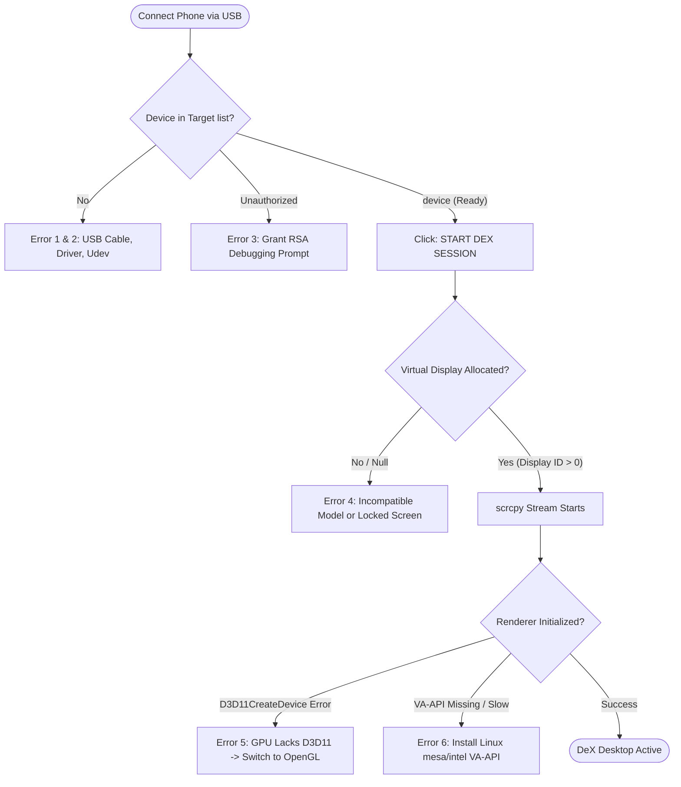

# ScrcpyDeX — Troubleshooting Guide & Technical FAQ

This document provides a comprehensive technical breakdown of potential runtime issues, error signatures, root causes, rapid remediation steps, and architectural integration guidelines for the user interface.

---

## 1. Quick Diagnostic Flowchart



---

## 2. Issue Catalog: Errors, Root Causes & Rapid Fixes

### Category A: Device Enumeration & ADB Connectivity

#### Issue 1: Device Not Detected (`No devices detected` / ComboBox Empty)
* **Error / Symptom:** ComboBox displays `No devices detected`. The device strip indicators show `--`.
* **Root Causes:**
  1. Device is connected with a power-only USB cable (lacks D+/D- data lines).
  2. USB Debugging is not enabled on the Android device.
  3. *(Windows)* Samsung Android USB composite driver is missing.
  4. *(Linux)* Udev rule for Samsung Vendor ID (`04e8`) is missing or user does not belong to `plugdev` group.
* **Rapid Fix:**
  * **Phone:** Settings > Developer Options > Enable **USB Debugging**.
  * **Hardware:** Reconnect using a certified USB 3.0 / 3.1 Type-C cable directly into the motherboard.
  * **Windows:** Install the Samsung Mobile USB Composite Driver or check optional updates.
  * **Linux:** Run `bash scripts/setup-linux.sh` or execute:
    ```bash
    sudo usermod -aG plugdev $USER
    sudo udevadm control --reload-rules && sudo udevadm trigger
    ```

#### Issue 2: Device Unauthorized (`Device detected (Unauthorized)`)
* **Error / Symptom:** Device is listed with status `unauthorized`. Session start is inhibited.
* **Root Causes:**
  1. Phone screen was locked when USB was plugged in; RSA prompt could not be displayed.
  2. Host RSA key was revoked or never accepted.
* **Rapid Fix:**
  1. Unlock the phone screen.
  2. Tap **"Always allow from this computer"** on the popup dialog and press **Allow**.
  3. If prompt does not appear: Go to **Settings > Developer Options > Revoke USB debugging authorizations**, then disconnect and reconnect the cable.

#### Issue 3: ADB Server Conflict (`adb server version does not match this client`)
* **Error / Symptom:** Log window continuously restarts ADB with messages like `killing... adb server version (41) doesn't match this client (39)`.
* **Root Causes:**
  * Multiple independent Android SDK installations (e.g., Android Studio, standalone scrcpy, Samsung Smart Switch, Vysor) running conflicting background ADB daemons.
* **Rapid Fix:**
  * Terminate competing daemons in task manager: `taskkill /F /IM adb.exe` (Windows) or `killall adb` (Linux).
  * Configure ScrcpyDeX to use the system ADB path in `config/settings.json`:
    ```json
    "paths": {
      "adbPath": "C:\\platform-tools\\adb.exe"
    }
    ```

#### Issue 4: Sudden Disconnect During Session / USB Dropping
* **Error / Symptom:** Session closes unexpectedly; telemetry drops immediately to `--`; scrcpy exits with code 1.
* **Root Causes:**
  * Windows USB Selective Suspend power-saving mode powers down the port.
  * Front-panel USB hub power fluctuation under high video bitrate load.
* **Rapid Fix:**
  * Connect to a high-power rear I/O port.
  * Windows: Edit Power Plan > Advanced Settings > **USB Settings > USB selective suspend setting > Disabled**.

---

### Category B: DeX Virtual Display & Server Activation

#### Issue 5: Virtual Display Allocation Failed (`Failed to allocate Samsung DeX virtual display ID`)
* **Error / Symptom:** Activation log outputs: `Failed to allocate Samsung DeX virtual display ID`. Session aborts.
* **Root Causes:**
  1. **Non-DeX Hardware:** The phone is not an official Samsung DeX capable model (e.g. Galaxy A-series, Galaxy M-series, Galaxy Z Flip). Only Galaxy S-series, Note-series, Z Fold, and Galaxy Tab S models contain the Samsung desktop compositor.
  2. **Device Locked / Knox Secure Storage:** Secure biometric lock or Knox security prevents `dumpsys display` virtual display reflection.
  3. **Stale Session:** A previously aborted DeX daemon did not unregister cleanly.
* **Rapid Fix:**
  * Ensure the phone screen is unlocked before clicking **START DEX SESSION**.
  * Click **Stop Session** or tap **Rescan** to trigger an automatic teardown broadcast (`ACTION_STOP_DESKTOP_MODE`).
  * Verify model compatibility against the supported device matrix (Galaxy S8 through S24, Note 8 through Note 20, Z Fold 1 through 6).

#### Issue 6: Server JAR Deployment Error (`scrcpydex-server.jar not found or failed to push`)
* **Error / Symptom:** Log: `scrcpydex-server.jar not found at '...'` or `Failed to push server JAR to device`.
* **Root Causes:**
  * `scrcpydex-server.jar` is missing from the local folder.
  * Target directory `/data/local/tmp/` on Android has permission corruption or exhausted internal storage.
* **Rapid Fix:**
  * Ensure `server/scrcpydex-server.jar` exists alongside the executable or at `/usr/share/scrcpydex/server/`.
  * Run ADB cleanup command:
    ```bash
    adb shell rm -f /data/local/tmp/scrcpydex-server.jar
    ```

---

### Category C: Video Streaming, Rendering & GPU Acceleration

#### Issue 7: Direct3D 11 Renderer Initialization Failure
* **Error Signature:**
  ```text
  ERROR: Could not create renderer: D3D11CreateDevice: Указанный интерфейс устройства или уровень компонента не поддерживается в данной системе.
  ```
  *(HRESULT 0x887A0004: DXGI_ERROR_UNSUPPORTED)*
* **Root Causes:**
  * Host GPU does not support DirectX 11 Feature Level 10_0 / 11_0.
  * Running inside a Virtual Machine or Remote Desktop (RDP) session without GPU passthrough.
  * Microsoft Basic Display Adapter is in use instead of dedicated vendor graphics driver.
* **Rapid Fix:**
  * Change **Render Driver** from `Auto` / `Direct3D 11` to `OpenGL` in **Display Parameters**.
  * Or edit `config/settings.json`:
    ```json
    "display": { "renderDriver": "opengl" }
    ```

#### Issue 8: Linux VA-API Hardware Video Acceleration Missing
* **Error / Symptom:** High CPU utilization, sluggish responsiveness, or dropped frames on Linux.
* **Root Causes:**
  * Host lacks VA-API hardware driver packages for the GPU (`i965`, `intel-media-driver`, or `mesa-va-drivers`).
* **Rapid Fix:**
  * Install the complete VA-API acceleration stack:
    ```bash
    sudo apt install va-driver-all vainfo mesa-va-drivers intel-media-va-driver
    ```
  * Verify hardware acceleration with `vainfo`.

#### Issue 9: Black Screen, Video Stutter or Artifacts
* **Error / Symptom:** Session starts, but video window is black or shows pixelated artifacts.
* **Root Causes:**
  1. H.265 (HEVC) selected on an older GPU that only supports H.264 hardware decoding (e.g. Intel Haswell / Broadwell).
  2. Bitrate set higher than USB channel bandwidth (e.g. 50 Mbps on a USB 2.0 interface).
* **Rapid Fix:**
  * Switch **Video Codec** to `h264`.
  * Set **Transmission Bitrate** to preset `16 Mbps` or `8 Mbps`.
  * Select resolution `1920x1080` @ 60 FPS.

---

### Category D: Peripherals, Mouse & Shortcut Routing

#### Issue 10: Mouse Pointer Lag or Dual Cursor Display
* **Error / Symptom:** Mouse pointer feels sluggish, or both Windows and DeX cursors are visible simultaneously.
* **Root Causes:**
  * Falling back to Android software touch injection (`aoa` or `sdk`) instead of hardware UHID emulation.
  * *(Linux)* `/dev/uhid` node lacks read/write permissions.
* **Rapid Fix:**
  * Enable the **"Native UHID Mouse"** switch in Quick Session Options.
  * *(Linux)* Verify `/dev/uhid` permissions:
    ```bash
    sudo chmod 666 /dev/uhid
    ```
    Or install the permanent udev rule from `packaging/linux/51-android.rules`.

#### Issue 11: Host Desktop Shortcuts Intercepted (`Alt+Tab`, `Super/Win Key`)
* **Error / Symptom:** Pressing `Alt+Tab` or `Windows Key` switches Windows/Linux windows instead of opening DeX app switcher or start menu.
* **Root Causes:**
  * "Forward Shortcut Keys" is toggled OFF.
  * *(Linux)* Running on native Wayland compositor where compositor security locks intercept modifier keys.
* **Rapid Fix:**
  * Toggle ON **"Forward Shortcut Keys"** (`--prefer-text` / `--shortcuts`).
  * On Linux, choose an **X11 / Xorg** session at the display manager login screen for complete keyboard grabbing.

#### Issue 12: Audio Latency, Crackling, or Buffer Underruns
* **Error / Symptom:** Audio crackles, pops, or desynchronizes from video during playback.
* **Root Causes:**
  * Sample rate mismatch between Android output (48,000 Hz) and PC audio device (e.g., 44,100 Hz).
  * Audio buffer set too low for high-load USB traffic.
* **Rapid Fix:**
  * In Windows Sound Control Panel > Device Properties > Advanced: Set format to **24-bit, 48000 Hz** or **16-bit, 48000 Hz**.
  * Keep **"Low Latency Audio"** enabled (streams continuous Opus buffer).

---

### Category E: Device Health & Thermal Protection

#### Issue 13: Phone Overheating or Battery Draining Rapidly
* **Error / Symptom:** Telemetry temperature meter shows `> 40°C` (Amber/Red warning); phone throttles.
* **Root Causes:**
  * Smartphone AMOLED panel is running at full brightness alongside DeX desktop rendering.
* **Rapid Fix:**
  * Toggle ON **"Turn off mobile screen"** (`-S`). The physical screen turns black while the DeX desktop continues running on the PC.
  * Toggle ON **"Stay Awake Device"** (`-w`) so the CPU does not bounce between deep sleep states.

---

## 3. UI Implementation Specification for the Interface Agent

This section defines the recommended UI components and behaviors for integrating these solutions directly into the Avalonia desktop interface.

### A. Contextual Dynamic Warning Banner
When an error occurs, the header warning strip (`StatusWarning`) should present an actionable 1-click button:

| Detected Error Condition | Displayed Message | 1-Click Action Button |
|---|---|---|
| `D3D11CreateDevice` / DirectX unsupported | `D3D11 unsupported on this GPU` | `[Switch to OpenGL]` |
| Device status `unauthorized` | `Phone unauthorized. Check screen.` | `[Help]` |
| `scrcpy` executable missing | `scrcpy binary not found in PATH` | `[Browse Path...]` |
| DeX virtual display allocation failed | `DeX mode allocation failed` | `[View Guide]` |

### B. Dedicated Help / FAQ Flyout Dialog
A secondary dialog or side drawer titled **"Diagnostic & Troubleshooting Assistant"**:
* **Search input:** Filters issue titles and error codes.
* **Accordion categories:**
  * 🔌 *Connection & ADB*
  * 🖥 *Display & Rendering*
  * 🖱 *Input & Mouse*
  * 🔊 *Audio & Latency*
* **"Run System Doctor" Button:** Executes `LinuxSetupChecker.RunAllChecks()` on Linux or platform path validations on Windows, displaying green checkmarks and red remediation instructions.
